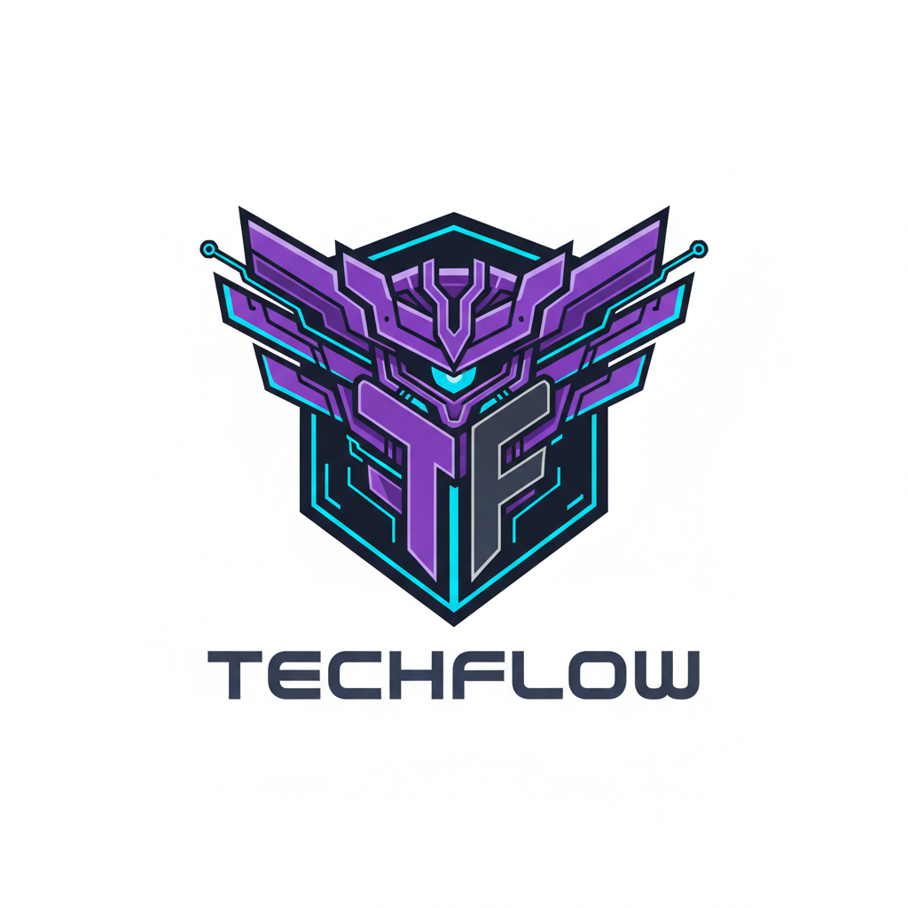
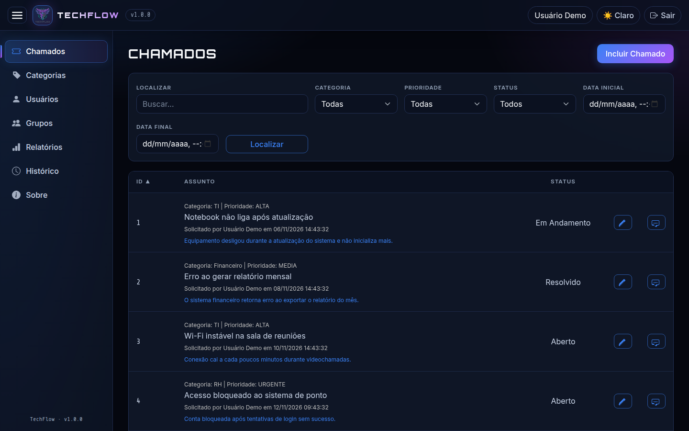
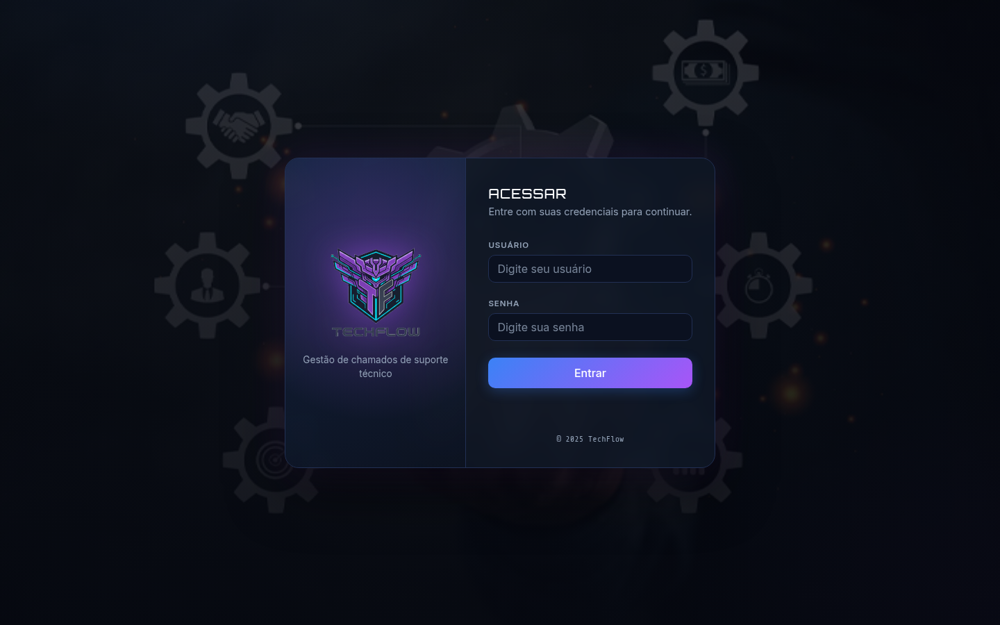
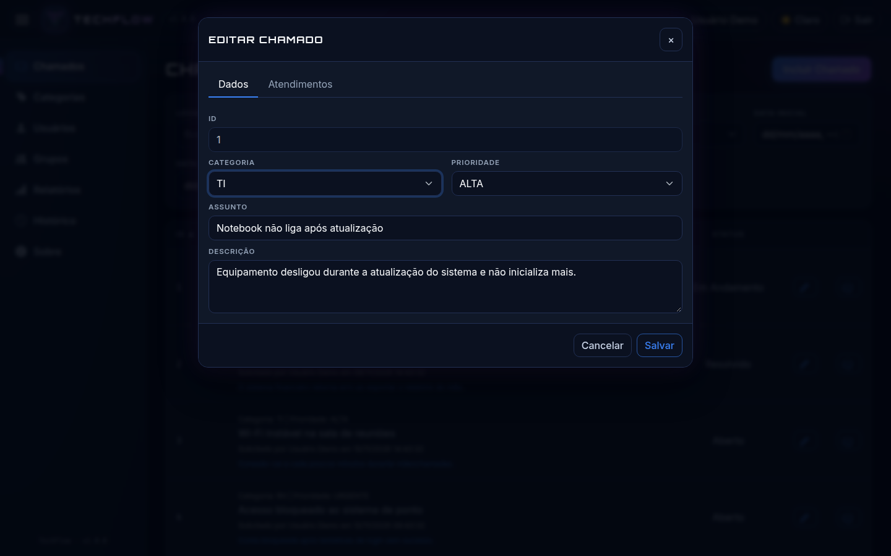
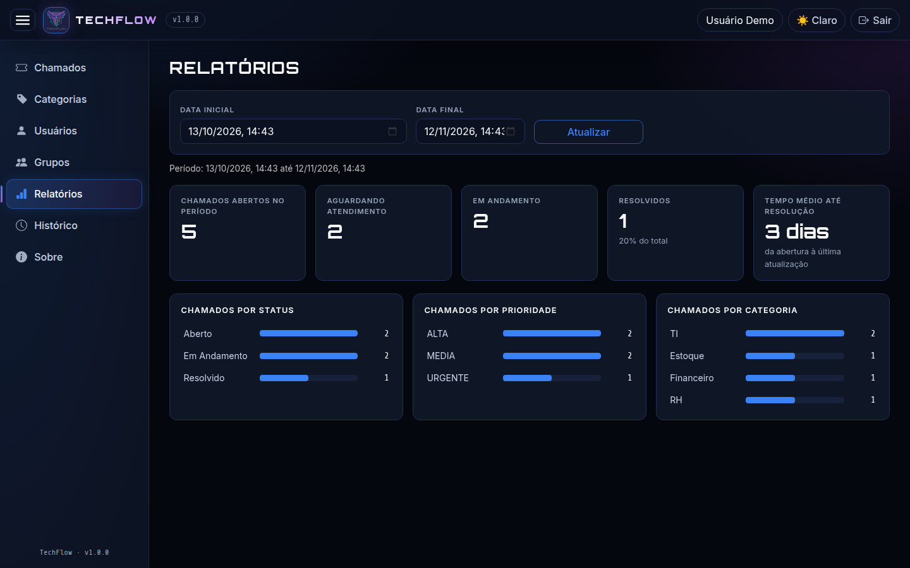
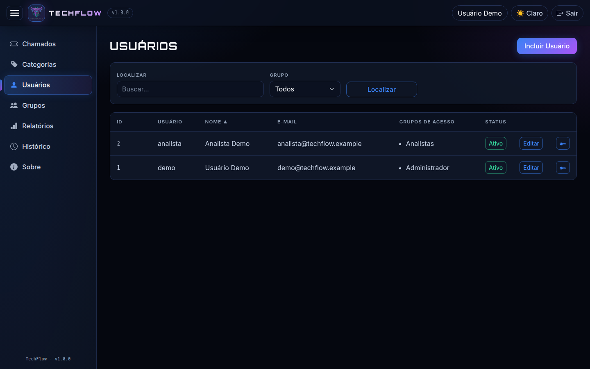
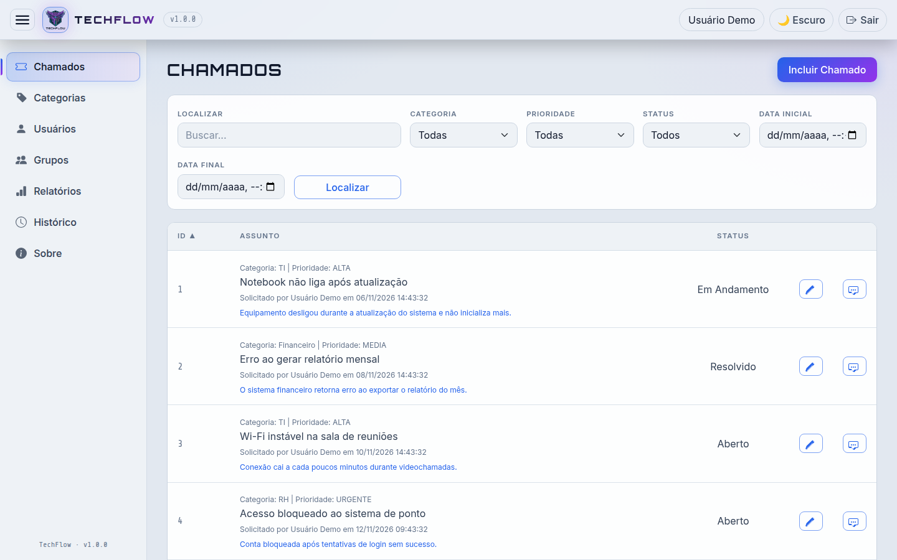
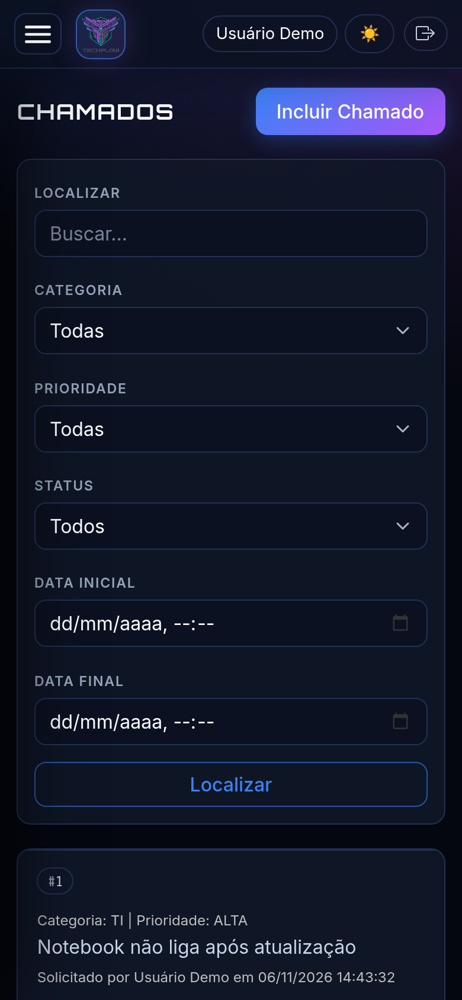
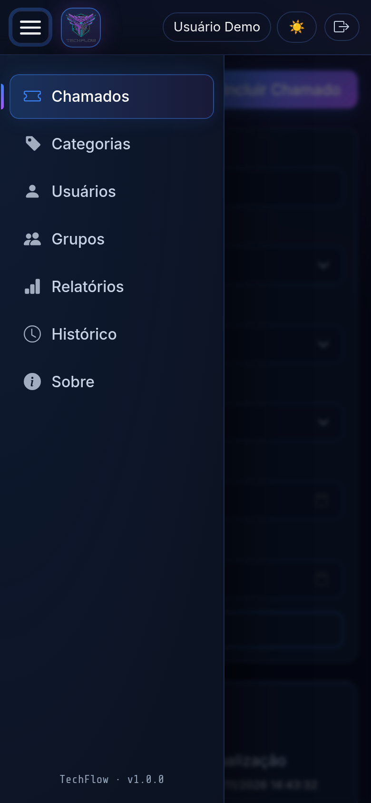
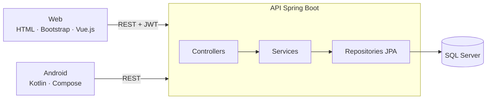

<div align="center">



# TechFlow Service Desk

**Portal de gestão de chamados de suporte técnico**

[](https://github.com/Yashatk/techflow-service-desk/actions/workflows/build.yml)


</div>

---

## Sobre

O TechFlow centraliza a abertura, triagem e acompanhamento de chamados de suporte técnico. Usuários registram solicitações; analistas definem prioridade, atualizam status e registram atendimentos; administradores gerenciam usuários, grupos e permissões, com trilha de auditoria das operações.

Nasceu em 2025 como projeto acadêmico da equipe **Tech-Flow**, do curso de Análise e Desenvolvimento de Sistemas da UNIP – São José dos Campos, desenvolvido com Scrum em 8 sprints. Atuei como **Scrum Master e desenvolvedor**. Esta é a versão consolidada que mantenho para estudo contínuo: reúne o código do produto, a nova interface responsiva e a documentação de produto e sprints da equipe original.

<p align="center">
  
</p>

## Proposta

Oferecer um portal que organize o atendimento técnico e a comunicação entre solicitantes e atendentes, reduzindo o tempo de resposta e a sobrecarga da equipe de TI. A proposta original da equipe também previa triagem e classificação automática de chamados com Inteligência Artificial — esse item **não foi implementado** e está listado em [próximos passos](#limitações-conhecidas-e-próximos-passos).

## Funcionalidades

- **Chamados** — abertura, edição, filtros por texto, categoria, prioridade, status e período; registro de atendimentos por chamado
- **Fluxo de status** — Aberto → Em Andamento → Resolvido / Cancelado
- **Prioridades** — Urgente, Alta, Média, Baixa
- **Cadastros** — categorias, usuários e grupos de acesso com permissões por funcionalidade
- **Segurança** — todas as rotas da API exigem token JWT (HMAC-SHA256) no header `Authorization`; login via `POST`; senhas com BCrypt (hashes MD5 antigos são migrados automaticamente no primeiro login); CORS restrito a origens configuradas
- **Relatórios** — indicadores do período (abertos, em andamento, resolvidos, tempo médio até resolução) e distribuição por status, prioridade e categoria
- **Auditoria** — histórico somente leitura de logins e alterações, com filtro por tipo e período
- **Interface** — responsiva (desktop, tablet e celular), tema escuro "HUD" com alternância para claro e i18n de mensagens (pt-BR / en-US)
- **Mobile** — protótipo Android (Jetpack Compose + Retrofit) para consulta de chamados
- **Desktop** — cliente Windows (C# / WinForms) para login, chamados, atendimentos e troca de senha, conectado ao mesmo banco

## Telas

| Login | Edição de chamado |
|---|---|
|  |  |
| **Relatórios** | **Usuários e grupos de acesso** |
|  |  |
| **Tema claro** | |
|  | |

**Mobile** — layout responsivo com menu lateral deslizante e listas em cartões:

<p align="center">
  
  &nbsp;&nbsp;
  
</p>

## Backlog do produto

Backlog definido pela equipe, por épico, com estimativa em story points (SP) e situação atual nesta versão.

| Épico | História | SP | Situação |
|---|---|:-:|---|
| 1. Cadastro e Autenticação | US01 — Cadastro de usuário final | 5 | ✅ Entregue |
| | US02 — Cadastro de técnico/atendente | 5 | ✅ Entregue |
| | US03 — Autenticação de login | 8 | ✅ Entregue |
| 2. Gestão de Chamados e Interações | US04 — Alteração de status | 8 | ✅ Entregue |
| | US05 — Comentários e atendimentos | 13 | ✅ Entregue |
| 3. Priorização e Filtros | US06 — Definição de prioridade | 5 | ✅ Entregue |
| | US07 — Filtros por data, status, prioridade e categoria | 13 | ✅ Entregue |
| 4. Relatórios e Auditoria | US08 — Log de alterações (auditoria) | 8 | ✅ Entregue |
| | US09 — Relatórios de desempenho | 13 | ✅ Entregue |
| 5. Interface Responsiva e Acessibilidade | US10 — Layout responsivo e acessível | 13 | ✅ Entregue |
| 6. Escalabilidade e Performance | US11 — Otimizações de performance | 13 | 🔄 Parcial |

## Sprints

| Sprint | Tema | Período |
|:-:|---|---|
| 1 | Fundação do portal de chamados | 05/08/2025 – 25/08/2025 |
| 2 | Interação e status dos chamados | 25/08/2025 – 01/09/2025 |
| 3 | Comunicação com o cliente e priorização | 01/09/2025 – 05/09/2025 |
| 4 | Busca e início da classificação | 05/09/2025 – 10/09/2025 |
| 5 | Filtros avançados e classificação | 14/09/2025 – 18/09/2025 |
| 6 | Histórico e relatórios iniciais | 20/09/2025 – 22/09/2025 |
| 7 | Exportação e interface responsiva | 23/09/2025 – 25/09/2025 |
| 8 | Acessibilidade, segurança e otimizações | 25/09/2025 – 01/10/2025 |

Detalhes em [backlog](Techflow_Base/Techflow_Web_Fonte/docs/database/backlog.md) e [sprints](Techflow_Base/Techflow_Web_Fonte/docs/database/sprints.md).

## Arquitetura



A API segue camadas `controller → service → repository`, com DTOs e conversores separando a entidade JPA do contrato HTTP. Os módulos são organizados por domínio: `support` (chamados, categorias, prioridades, status) e `sys` (usuários, grupos, acessos, histórico).

## Stack

| Camada | Tecnologias |
|---|---|
| Backend | Java 17, Spring Boot 3.5, Spring Security, Spring Data JPA / Hibernate, JJWT, Log4j2 |
| Banco de dados | Microsoft SQL Server 2019 |
| Frontend web | HTML5, CSS3, Bootstrap 5, Vue.js |
| Mobile | Kotlin, Jetpack Compose, Retrofit |
| Desktop | C#, .NET Framework, WinForms |
| Dados | Flyway (migrations versionadas), SQL Server |
| Observabilidade | Logs JSON (ECS) com `correlationId` por requisição, erros no formato RFC 7807 |
| Qualidade | JUnit 5, Mockito, MockMvc, JaCoCo, GitHub Actions, Dependabot, SonarQube, Semgrep, Trivy |
| Infra | Docker, Docker Compose |
| Processo | Scrum, Figma, Astah (modelagem) |

## Como executar

### Com Docker (recomendado)

Pré-requisito: Docker com Compose v2.

```bash
git clone https://github.com/Yashatk/techflow-service-desk.git
cd techflow-service-desk/Techflow_Base/Techflow_Web_Fonte
cp .env.example .env   # preencha DB_PASSWORD (senha forte) e JWT_SECRET
docker compose up --build
```

Acesse **http://localhost:8089** com o usuário de demonstração **`demo` / `demo123`**.
O compose sobe o SQL Server, cria o banco, inicia a API e carrega dados fictícios de exemplo ([`demo-seed.sql`](Techflow_Base/Techflow_Web_Fonte/docs/database/demo-seed.sql)).

### Sem Docker

Requer JDK 17+, Maven e um SQL Server acessível.

```bash
cd Techflow_Base/Techflow_Web_Fonte
cp .env.example .env   # ajuste DB_URL, DB_USERNAME, DB_PASSWORD e JWT_SECRET
set -a && . ./.env && set +a
mvn spring-boot:run
```

### Configuração

| Variável | Obrigatória | Descrição |
|---|---|---|
| `DB_URL` | não | JDBC do SQL Server (padrão: `localhost:1433/techflow`) |
| `DB_USERNAME` / `DB_PASSWORD` | sim | Credenciais do banco |
| `JWT_SECRET` | sim | Chave de assinatura do JWT, mínimo 32 caracteres |
| `ADMIN_DEFAULT_PASSWORD` | não | Se definida, cria o usuário `admin` no primeiro boot |
| `APP_TIMEZONE` | não | Fuso usado para interpretar os filtros de data (padrão: `America/Sao_Paulo`) |
| `CORS_ALLOWED_ORIGINS` | não | Origens liberadas para chamar a API, separadas por vírgula (padrão: `http://localhost:8089`) |

Nenhuma credencial é versionada: tudo vem de variáveis de ambiente (`.env` está no `.gitignore`).

## Estrutura

```
Techflow_Base/
├── Techflow_Web_Fonte/          # API Spring Boot + front web
│   ├── src/main/java/com/techflow/ws/
│   │   ├── config/              # segurança, JWT, CORS
│   │   ├── support/             # chamados (controller, service, repository, dto, entity) e relatórios
│   │   └── sys/                 # usuários, grupos, acessos, histórico
│   ├── src/main/resources/
│   │   ├── static/              # páginas web (HTML, CSS, JS)
│   │   ├── db/migration/        # migrations Flyway (V1 = schema base)
│   │   └── application.yml
│   ├── src/test/java/           # testes unitários
│   ├── docs/database/           # modelo, diagrama, manual, backlog, sprints, seed de demo
│   ├── Dockerfile
│   └── docker-compose.yml
├── Techflow_Mobile/             # app Android (Kotlin + Compose)
└── Techflow_Windows_Fonte/      # cliente desktop Windows (C# / WinForms)
```

## Documentação do projeto

- [Backlog do produto](Techflow_Base/Techflow_Web_Fonte/docs/database/backlog.md) · [Sprints](Techflow_Base/Techflow_Web_Fonte/docs/database/sprints.md)
- [Modelo de dados](Techflow_Base/Techflow_Web_Fonte/docs/database/techflow_db.png) · [Diagrama](Techflow_Base/Techflow_Web_Fonte/docs/database/diagrama.pdf)
- [Manual do usuário](Techflow_Base/Techflow_Web_Fonte/docs/database/Manual%20do%20Usuario.pdf)

## Limitações conhecidas e próximos passos

Projeto acadêmico, sem uso em produção. Pontos mapeados para evolução:

- [x] Autenticação obrigatória em todos os endpoints, com JWT no header `Authorization`
- [x] Hash de senha BCrypt, com migração automática dos hashes MD5
- [x] Login via `POST` (credenciais fora da URL)
- [x] CORS restrito a origens configuradas (`CORS_ALLOWED_ORIGINS`)
- [ ] Cliente desktop consumir a API em vez de conectar direto no banco — até lá, use um usuário de banco com privilégios mínimos, nunca `sa`
- [x] Filtros de período no fuso do usuário (`APP_TIMEZONE`, padrão America/Sao_Paulo)
- [x] US09 — relatórios de desempenho
- [x] Migrations versionadas com Flyway (Hibernate apenas valida o schema)
- [x] Injeção de dependências por construtor; erros técnicos em RFC 7807; logs JSON com `correlationId`
- [x] Testes de serviço e de segurança (MockMvc) e cobertura JaCoCo no CI
- [ ] Ampliar a cobertura de testes dos serviços legados e adicionar testes de integração com Testcontainers
- [ ] Migrar o front para Vue 3 + Vite + TypeScript (hoje Vue 2 em páginas estáticas)
- [ ] Integrar o app Android aos endpoints reais da API, com login e token
- [ ] Publicar uma demo online e levar a análise do SonarQube para o CI
- [ ] Triagem e classificação automática de chamados com IA (proposta original da equipe)

## Equipe original — Tech-Flow

Equipe acadêmica da UNIP – São José dos Campos que concebeu o produto.

| Nome | Papel | GitHub |
|---|---|---|
| Tainara Lais Viana Mota | Product Owner | [@TainaraViana](https://github.com/TainaraViana) |
| André Takashi Prado Takamura | Scrum Master / Desenvolvedor | [@Yashatk](https://github.com/Yashatk) |
| Fabrício Santos Cavalcante | Desenvolvedor | [@Kinnube](https://github.com/Kinnube) |
| Thiago Paulino da Silva | Desenvolvedor | [@thiagooo9](https://github.com/thiagooo9) |
