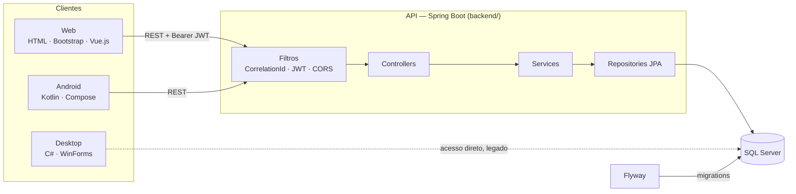
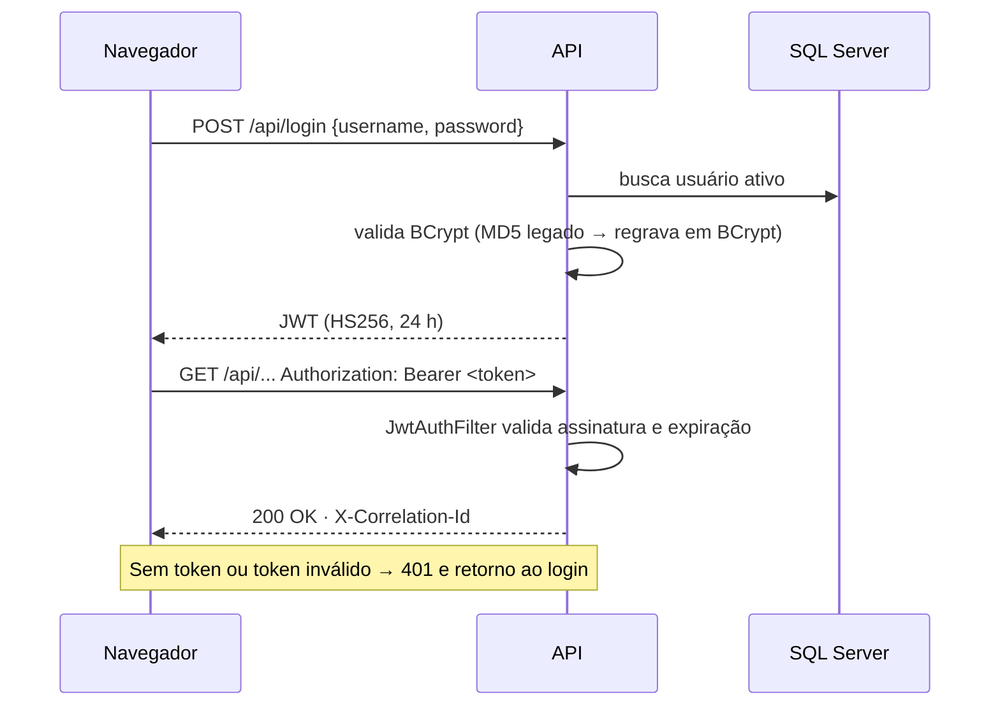
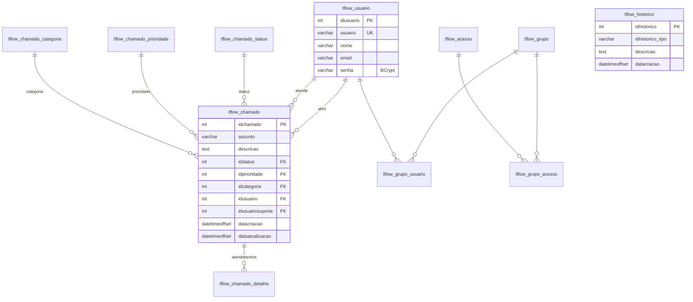

# Arquitetura

## Componentes

- **backend/** — API REST e front web servido pelo próprio Spring Boot (`src/main/resources/static`).
- **mobile/** — protótipo Android; ainda não integrado à API autenticada.
- **desktop/** — cliente Windows legado que acessa o banco diretamente (ver [SECURITY.md](../../SECURITY.md)).

## Autenticação

## Modelo de dados

O schema é versionado em [`backend/src/main/resources/db/migration`](../../backend/src/main/resources/db/migration).

## Decisões técnicas

| Decisão | Motivo |
|---|---|
| JWT stateless no header `Authorization` | API sem sessão de servidor; CSRF não se aplica porque nenhum cookie autentica |
| BCrypt com migração no login | Elimina MD5 sem exigir troca de senha de todos os usuários |
| Flyway com baseline na V1 | Bancos já existentes (criados pelo antigo `ddl-auto`) migram sem recriar dados |
| Erros técnicos em RFC 7807; regras de negócio em `ServiceResponse` | Padroniza falhas sem quebrar o contrato que o front já usa |
| Logs JSON (ECS) com `correlationId` | Rastreio de uma requisição de ponta a ponta e ingestão direta em ferramentas de log |
| Cálculo de relatórios em classe pura (`TicketReportCalculator`) | Regra testável sem banco nem framework |
